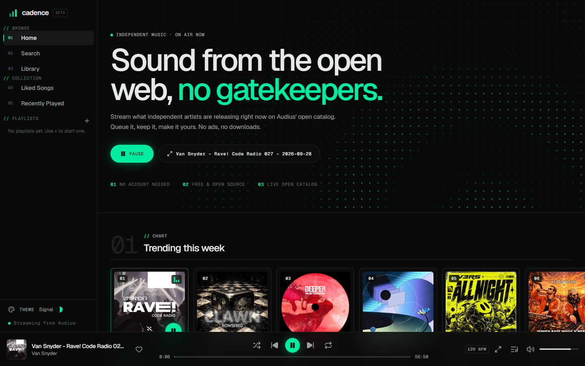
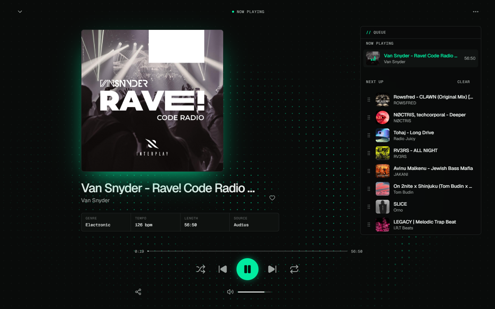
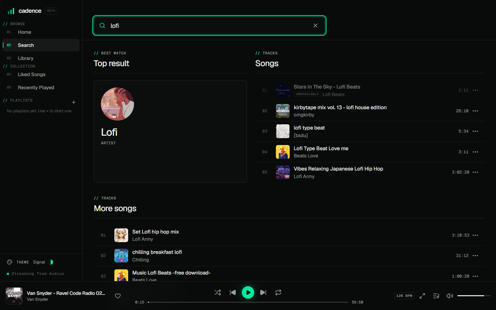
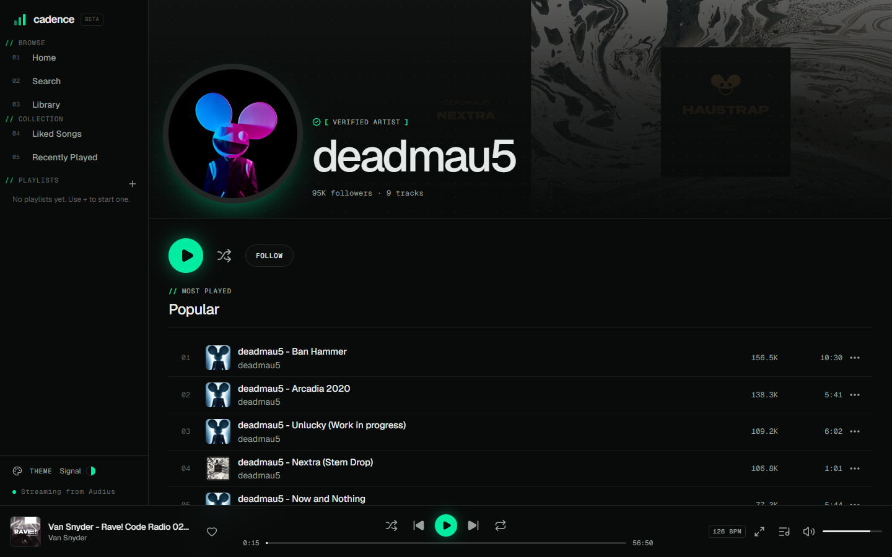
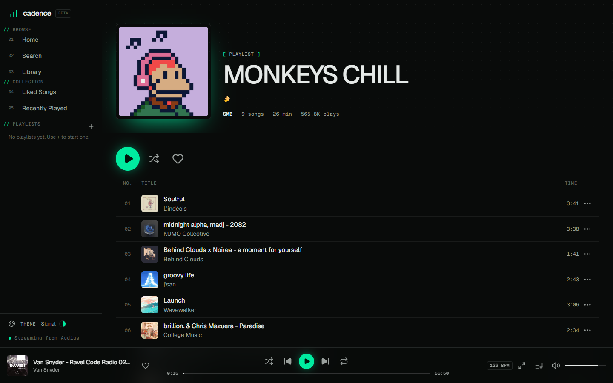
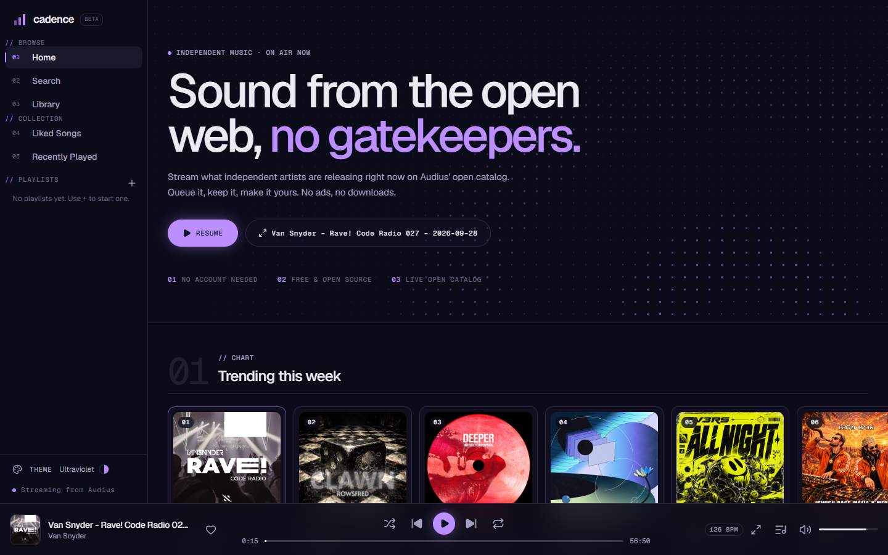
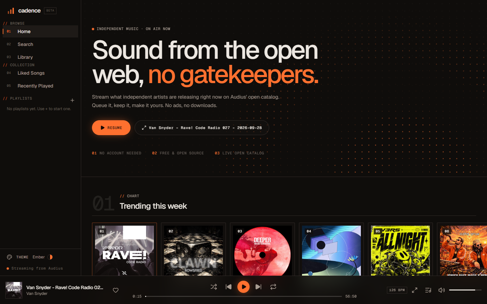
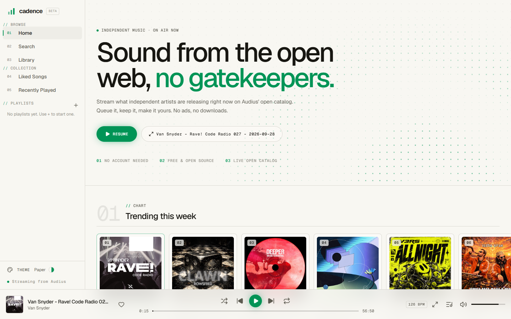
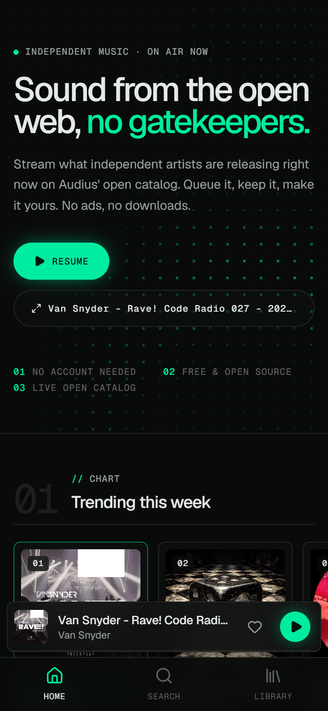
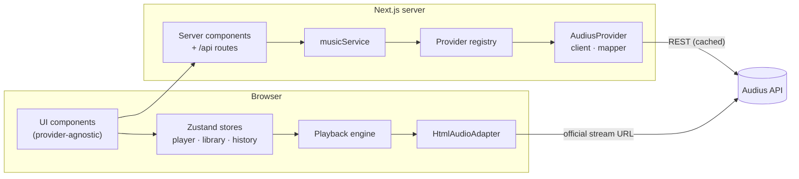

<div align="center">


# Cadence

**Sound from the open web, no gatekeepers.**

A free, open-source music player for independent music. Search, stream, queue and collect.
No account, no ads, no downloads.

[**Live demo →**](https://cadence-two-steel.vercel.app)

[](https://github.com/dCataliNN/cadence/actions/workflows/ci.yml)
[](LICENSE)


[](https://cadence-two-steel.vercel.app)

<br />



</div>

---

## Contents

- [Why Cadence](#why-cadence)
- [Features](#features)
- [Screenshots](#screenshots)
- [Quick start](#quick-start)
- [Architecture](#architecture)
- [Design system](#design-system)
- [Legal & content](#legal--content)
- [Roadmap](#roadmap)
- [Contributing](#contributing)
- [License](#license)

## Why Cadence

Most "open-source Spotify clones" are a UI over hard-coded JSON. Cadence is a real player:

- **Real music, legitimately.** It streams from [Audius](https://audius.co), an open catalog of independent artists, using its official API and stream endpoint. Nothing is ripped, proxied or re-hosted.
- **Provider-agnostic by design.** Audius is the first source, not the only one. Every provider implements one interface, and the UI never sees provider-specific data.
- **Works without an account.** Likes, playlists, history and your queue live on your device and survive reloads.
- **Its own identity.** A spec-sheet aesthetic, four themes and a tempo-driven generative visualiser, not another green-on-black clone.

## Features

|                         |                                                                                                                                                                          |
| ----------------------- | ------------------------------------------------------------------------------------------------------------------------------------------------------------------------ |
| 🎧 **Instant playback** | Pick a track and it plays. One shared audio engine keeps playing as you navigate.                                                                                        |
| 🔎 **Search**           | Debounced as you type, with stale requests cancelled. Results show a top result, songs, artists, albums and playlists, plus recent searches. The query lives in the URL. |
| 📻 **Discover**         | Weekly chart, underground hits, popular playlists, genre pages, and "Because you listen to…" picks seeded by your history.                                               |
| 📜 **Queue**            | Now playing and next up. Play next, add to queue, drag or keyboard reorder, remove, clear.                                                                               |
| 🔀 **Shuffle & repeat** | Shuffle is reversible, so turning it off restores the original order. Repeat off, all or one.                                                                            |
| 💚 **Library**          | Liked songs, your own playlists (create, rename, reorder, delete), saved playlists, followed artists, listening history.                                                 |
| 🖥️ **Stage**            | A full-screen now-playing view with track specs and a generative field that pulses on the song's tempo.                                                                  |
| 🎨 **Themes**           | Signal, Ultraviolet, Ember and Paper, switchable live and compatible with [tweakcn](https://tweakcn.com) exports.                                                        |
| ⌨️ **Keyboard**         | <kbd>Space</kbd> play/pause · <kbd>←</kbd>/<kbd>→</kbd> seek · <kbd>M</kbd> mute · <kbd>N</kbd> next · <kbd>P</kbd> previous                                             |
| 📱 **Everywhere**       | Sidebar on desktop, icon rail on tablet, bottom nav and mini player on phones. OS media keys and lock-screen controls work via the Media Session API.                    |

## Screenshots

<table>
  <tr>
    <td width="50%"><br /><sub><b>Stage</b>: full-screen now playing with queue and track specs</sub></td>
    <td width="50%"><br /><sub><b>Search</b>: top result, songs, artists and playlists</sub></td>
  </tr>
  <tr>
    <td><br /><sub><b>Artist</b>: popular tracks, releases, related artists</sub></td>
    <td><br /><sub><b>Playlist</b>: spec-sheet track table</sub></td>
  </tr>
</table>

<details>
<summary><b>Themes &amp; mobile</b></summary>
<br />

| Ultraviolet                                                                  | Ember                                                            | Paper                                                            |
| ---------------------------------------------------------------------------- | ---------------------------------------------------------------- | ---------------------------------------------------------------- |
|  |  |  |

<p align="center"></p>

</details>

## Quick start

Requires **Node.js 20.9+**.

```bash
git clone https://github.com/dCataliNN/cadence.git
cd cadence
npm install
npm run dev
```

Open <http://localhost:3000>. No API keys or secrets are required.

### Scripts

| Command             | Description                      |
| ------------------- | -------------------------------- |
| `npm run dev`       | Start the dev server (Turbopack) |
| `npm run build`     | Production build                 |
| `npm start`         | Serve the production build       |
| `npm run typecheck` | TypeScript, no emit              |
| `npm run lint`      | ESLint                           |
| `npm test`          | Unit tests (Vitest)              |
| `npm run format`    | Format with Prettier             |

### Environment variables

All optional. Copy `.env.example` to `.env.local` to override.

| Variable                      | Default                 | Description                                                       |
| ----------------------------- | ----------------------- | ----------------------------------------------------------------- |
| `NEXT_PUBLIC_AUDIUS_APP_NAME` | `Cadence`               | App name sent to Audius with every request (public, not a secret) |
| `AUDIUS_API_BASE_URL`         | `https://api.audius.co` | Override the Audius API host                                      |
| `NEXT_PUBLIC_SITE_URL`        | Vercel production URL   | Canonical URL for social preview links                            |

### Deploy your own

[](https://vercel.com/new/clone?repository-url=https%3A%2F%2Fgithub.com%2FdCataliNN%2Fcadence)

No configuration needed. It works out of the box on Vercel's free tier.

## Architecture



```
src/
├── app/                 Routes: server components fetch catalog data; library pages are client-side
│   └── api/             search + recommendations route handlers (input-validated)
├── components/          UI: player/ tracks/ artists/ playlists/ search/ home/ layout/ visual/ ui/
├── providers/           The only code that knows about a specific music source
│   ├── types.ts         MusicProvider interface, capabilities, ProviderError
│   ├── registry.ts      source → provider
│   └── audius/          client (timeouts, bounded retries) · raw types · mapper · provider
├── services/music/      Server-side facade used by pages and API routes
├── lib/
│   ├── queue.ts         Pure queue logic: shuffle/unshuffle, repeat, insert, move, remove
│   ├── history.ts       Play-counting rule, dedupe, top genre
│   ├── playback/        Engine, adapter interface, HTML audio adapter, Media Session
│   └── themes.ts        Theme registry
├── stores/              player (persisted) · progress (transient) · library · history · search · ui
└── types/music.ts       Normalized domain models: Track, Artist, Playlist, QueueItem…
```

**Key decisions**

- **Normalized models with global IDs** (`audius:abc123`). Tracks from different providers can share a queue or playlist. Adding a provider means implementing `MusicProvider`, writing a mapper with tests, and registering it; the UI doesn't change.
- **One audio engine.** The store holds _intent_ (queue, play/pause, volume). `lib/playback/engine.ts` is the only code that touches audio and reconciles that intent with a `PlaybackAdapter`. A YouTube IFrame or local-file adapter can slot in later.
- **Fair play counts.** Audio loads only when you press play. Restoring a session after a reload never requests a stream, so artists don't get phantom plays.
- **Resilience.** Provider requests time out and retry with backoff (rate limits are never retried). A broken track is skipped, and after three consecutive failures playback stops. Each home shelf fails independently, and artwork falls back across mirror hosts.
- **Cheap persistence.** Playback position (4×/s) lives in a non-persisted store, so it never thrashes `localStorage`.

## Design system

Cadence draws on three references without copying any of them:

- **Spec-sheet typography** (after [neon.com](https://neon.com)). Geist plus Geist Mono for labels, indices, timecodes and counts. Tight-tracked medium-weight headlines, oversized faint section numerals, hairline rules.
- **Theme tokens** (after [tweakcn](https://tweakcn.com)). Every colour, radius and font uses the shadcn/tweakcn variable contract in oklch. To add a theme, paste a tweakcn export's dark variables into a new `[data-theme]` block in `src/app/globals.css` and register it in `src/lib/themes.ts`. Radius tokens derive from `--radius`, which is why the `0rem` Ember theme is square everywhere.
- **Generative motion** (after [Originkit](https://www.originkit.dev)). `SignalField` is a pointer-reactive dot field. It deliberately doesn't analyse audio: that would require CORS on every content node, and it stops playback on iOS when the screen locks. Instead it pulses on the track's BPM from Audius metadata, anchored to the playback position. Tracks with no known tempo only drift. It honours `prefers-reduced-motion` and pauses offscreen.

## Legal & content

Cadence **does not host, rip, download or proxy audio.** Audio streams directly from Audius' official `/v1/tracks/{id}/stream` endpoint to your browser. Gated or paid tracks are shown as unavailable rather than worked around. Likes and playlists store only provider references and a small metadata snapshot, never audio.

All music belongs to its artists and is provided via [Audius](https://audius.co). Track, artist and playlist pages link back to the original. Any future YouTube support will use only the official IFrame Player API.

## Roadmap

- [x] Foundation: Next.js 16, strict TypeScript, Tailwind 4, ESLint, Prettier, Vitest, CI
- [x] Provider abstraction and Audius provider
- [x] Player engine: queue, shuffle, repeat, keyboard shortcuts, Media Session
- [x] Local library: likes, playlists, follows, history, recent searches
- [x] Design system: themes, Stage, generative visuals, app icons, social cards
- [ ] Accounts and cloud sync (PostgreSQL + Prisma + auth) with guest-data import
- [ ] Playlist polish: custom covers, public/private, drag-and-drop
- [ ] More providers: local files, Jamendo, YouTube (official player)
- [ ] PWA: installable, offline app shell (never offline audio caching)
- [ ] Lyrics, equalizer, crossfade, Last.fm scrobbling

## Contributing

Contributions are welcome. Read [CONTRIBUTING.md](CONTRIBUTING.md) first; the ground rules on legitimate sources and provider isolation matter. Before opening a PR:

```bash
npm run typecheck && npm run lint && npm test && npm run build
```

## License

[MIT](LICENSE) © Cadence contributors. Music remains the property of its respective artists.
